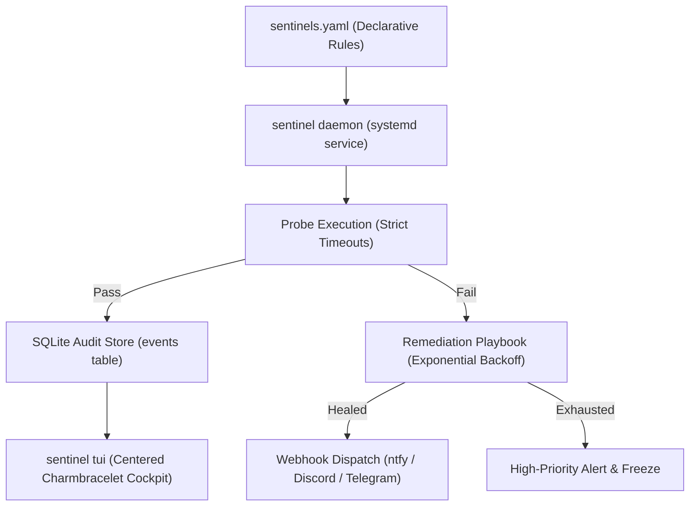

# 🛡️ Beelzebub

> **Autonomous Site Reliability Engineering (SRE) Cockpit & Self-Healing Sentinel for Linux Homelabs.**

[](https://golang.org)
[](LICENSE)
[]()
[]()

---

## 📖 Overview

Instead of passive resource monitoring (CPU/RAM meters that page you at 3 AM), **Beelzebub** acts as an **active, autonomous operator**:

1. **Continuous Watchdog**: Evaluates user-defined declarative health probes in the background.
2. **Deterministic Remediation**: Executes automated playbooks (remounting storage, resetting WireGuard interfaces, restarting containers) when failures occur.
3. **Local SQLite Audit Trail**: Persists incident timelines, execution durations, and stdout/stderr outputs to a zero-CGO SQLite database.
4. **Targeted Webhooks**: Dispatches notifications via **ntfy**, **Discord**, or **Telegram** only when interventions succeed (`healed`) or exhaust retries (`exhausted`).
5. **Centered Terminal UI (TUI)**: Provides a keyboard-driven Charmbracelet (`bubbletea` + `lipgloss`) cockpit when logging into your server via SSH.



---

## ⚡ Quickstart

### 1. Build and Run Directly
```bash
# Clone the repository
git clone https://github.com/GeorgeDeveloperJ/Beelzebub.git
cd Beelzebub

# Build standalone stripped static binary
./scripts/build.sh

# Launch the interactive centered TUI cockpit
./dist/sentinel
```

### 2. Automated System Installation
```bash
# Install binary to /usr/local/bin, create /var/lib/beelzebub, and install systemd unit
sudo ./install.sh

# Enable and start the background daemon
sudo systemctl enable --now sentinel.service

# Inspect live daemon logs
journalctl -u sentinel.service -f
```

---

## ⚙️ Declarative Configuration (`sentinels.yaml`)

Probes and remediations are defined via human-readable declarative YAML:

```yaml
version: "1"
global:
  check_interval_default: "60s"
  notifications:
    provider: "ntfy" # or "discord", "telegram"
    endpoint: "https://ntfy.sh/your-topic-here"
    alert_on: ["healed", "exhausted"] # suppress normal pass checks

sentinels:
  # Example 1: Shell canary file probe with automated remount
  - name: "media-storage-mount"
    interval: "30s"
    timeout: "5s"
    probe:
      type: "shell"
      command: "test -f /mnt/media/.canary"
    remediation:
      max_retries: 3
      backoff: "10s"
      command: "mount -a || systemctl restart autofs"
    on_exhausted: "Failed to remount /mnt/media after 3 attempts."

  # Example 2: Numerical threshold probe
  - name: "wan-speedtest-gateway"
    interval: "30m"
    timeout: "60s"
    probe:
      type: "threshold"
      # Command returns a float/integer number (Mbps)
      command: "speedtest --format=json | jq '.download.bandwidth / 125000'"
      min_threshold: 50.0 # Alert if bandwidth drops below 50 Mbps
    remediation:
      max_retries: 2
      backoff: "15s"
      command: "systemctl restart wg-quick@wg0"
    on_exhausted: "WAN speed remained degraded below 50 Mbps."
```

---

## 🖥️ Interactive Operator TUI Cockpit

When logging in over SSH, launch the TUI by running `sentinel` (or `sentinel tui`):

```text
       ┌────────────────────────────────────────────────────────────────────────┐
       │ 🛡️  BEELZEBUB — Autonomous SRE Sentinel Cockpit  2026-10-13 15:45:00    │
       │                                                                        │
       │ ── SENTINEL FLEET OVERVIEW ──────────────────────────────────────────  │
       │   SENTINEL                  HEALTH       RETRIES    LAST CHECK  DUR    │
       │ > media-storage-mount       HEALTHY      0          15:44:30    12ms   │
       │   wan-speedtest-gateway     HEALTHY      0          15:30:00    19ms   │
       │                                                                        │
       │ ── RECENT INCIDENT & AUDIT STREAM ───────────────────────────────────  │
       │   15:44:30 [PASS       ] media-storage-mount     check passed (12ms)   │
       │   15:30:00 [PASS       ] wan-speedtest-gateway   85.4 Mbps (19ms)      │
       │                                                                        │
       │   [space/r] Force Check • [x] Remediation • [s] Diagnostic • [q] Quit  │
       └────────────────────────────────────────────────────────────────────────┘
```

### Keybindings
| Key | Action |
| :--- | :--- |
| `j` / `k` or `↑` / `↓` | Navigate and select sentinel in the fleet table |
| `[space]` or `r` | Force instant probe execution for selected sentinel |
| `x` | Force manual remediation playbook execution on demand |
| `s` | Run on-demand diagnostic / speedtest check |
| `c` | Clear/reset consecutive failure counters |
| `q` or `Ctrl+C` | Quit cockpit cleanly |

---

## 🏗️ Architecture & Technical Stack

- **Go 1.24+**: Pure-Go static binary with zero external runtime dependencies.
- **SQLite Engine (`modernc.org/sqlite`)**: Zero-CGO pure-Go database engine running in WAL mode for ultra-low latency write operations.
- **TUI Framework**: Charmbracelet ecosystem (`bubbletea`, `lipgloss`).
- **Process Isolation**: Commands execute via `sh -c` under strict `context.WithTimeout` to guarantee no hanging orphan processes.
- **Signal Handling**: POSIX `SIGINT`, `SIGTERM`, and `SIGHUP` trapping for clean graceful shutdowns.

---

## 🧪 Testing & Verification

Run the comprehensive unit test suite with race detector:

```bash
go test -v -race ./...
```

---

## 📜 Uninstallation

To cleanly remove Beelzebub and the systemd unit:

```bash
sudo ./install.sh uninstall
```

*(Configuration files in `/etc/beelzebub` and database files in `/var/lib/beelzebub` are preserved by default).*

---

## 📄 License

MIT License. Designed for homelab and edge infrastructure reliability.
